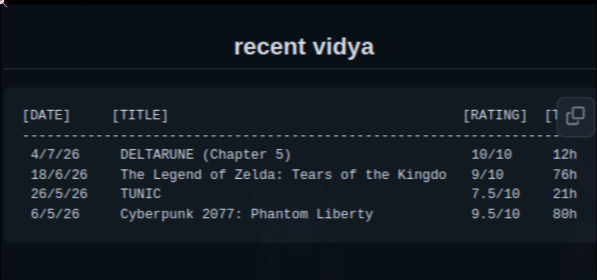

# rasmalaaiPiVidyaSync 

a resource-optimized, bare-metal telemetry daemon and serverless edge rendering pipeline built for the rasmalaaiPi ecosystem. 

it interfaces an asynchronous google sheets database with localized linux init systems, extracting multi-dimensional arrays and pushing raw json state to version control. a decoupled serverless edge api then intercepts this state and dynamically compiles a scalable svg matrix to inject deterministic visual updates directly into my profile `readme.md`.

i had a lot of video game data lying around for more than 2 years, figured making use of it by displaying it on my profile would give me some sense of productivity instead of being autistically fixated on logging everything for reasons i dont know. 

* **spreadsheet here**: https://docs.google.com/spreadsheets/d/1W9je3_pr-Pd608ET2m4Zm-GTyg7kLzrdRGCktyuXpXk/edit?usp=sharing.

the project currently only works for my personal spreadsheet, could add options for more configurations in future.

## evolution & demo output

this project started as a brute-force text script before evolving into a fully decoupled edge rendering pipeline. 

### v1.0: the prototype (markdown injection)
> the original python daemon used regex to dynamically overwrite the file tree, injecting a raw markdown table directly between `<!-- GAMES:START -->` html comments in my profile's readme.
<div align="center">
  
</div>

### v2.0: headless edge rendering (current)
> the daemon now strictly serializes state to a bundled JSON artifact (`api/telemetry.json`), dropping all git-injection responsibilities. Next.js statically builds the state into an offline-ready, fully cached SVG without external runtime dependencies.
<div align="center">
  
</div>

---

## architecture & state-flow

1. **Pi Daemon:** reads google sheets → downloads artwork from RAWG as base64 → writes `api/telemetry.json`.
2. **Git Pub/Sub:** daemon commits and pushes the new state bundle to GitHub.
3. **Vercel Edge:** GitHub push triggers Vercel deployment. Next.js statically evaluates the JSON state at build-time.
4. **SVG Generation:** GitHub profile requests the Vercel API. Satori renders the bundled state synchronously with zero external latency.

## installation & local development

### 1. clone and install
```bash
git clone https://github.com/asitos/rasmalaaiPiVidyaSync.git
cd rasmalaaiPiVidyaSync
```

### 2. daemon setup
```bash
cd daemon
python3 -m venv venv
source venv/bin/activate
pip install -r requirements.txt
```
place `credentials.json` (google service account) and `rawgapi.txt` in the repository root.

### 3. api setup
```bash
cd ../api
npm install
npm run dev
# deployment card is hosted at http://localhost:3000/api/card
```

### 4. systemd deployment
install the `.service` and `.timer` files located in `systemd/` to `/etc/systemd/system/`.
```bash
sudo cp systemd/vidyad.* /etc/systemd/system/
sudo systemctl daemon-reload
sudo systemctl enable --now vidyad.timer
```
